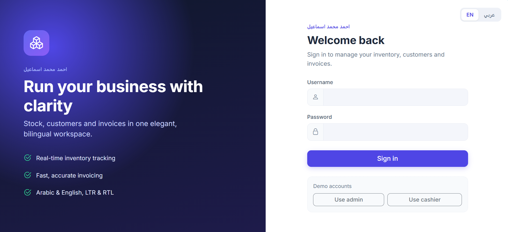
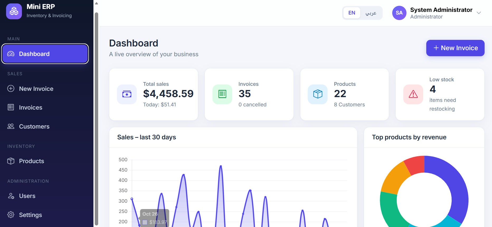
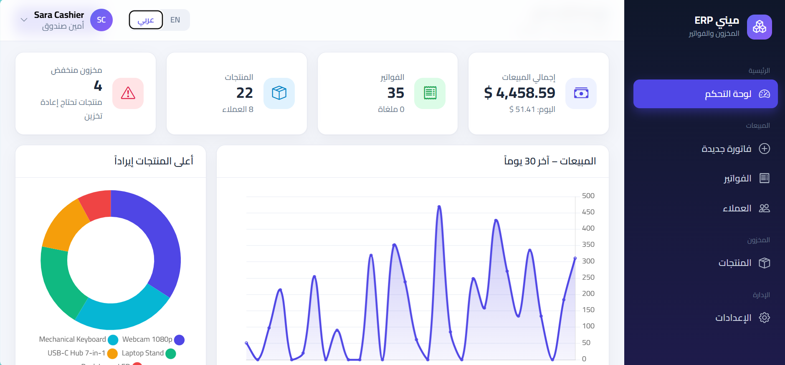
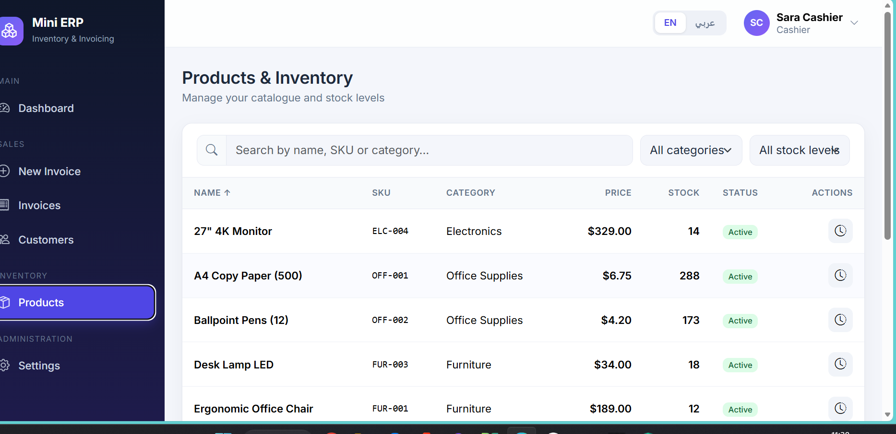
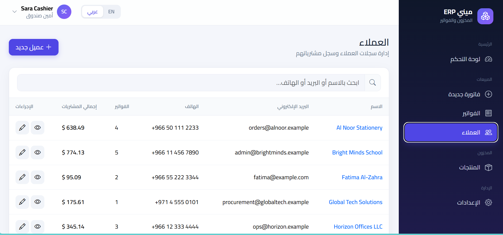
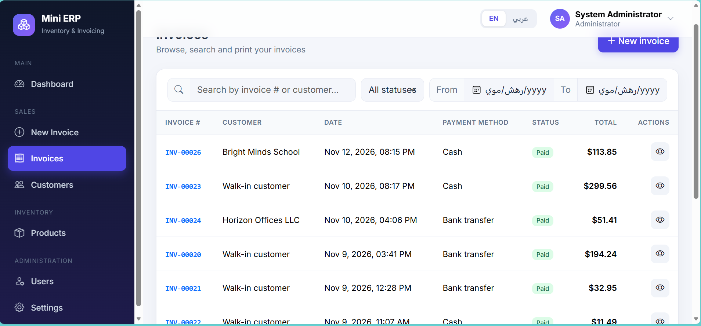
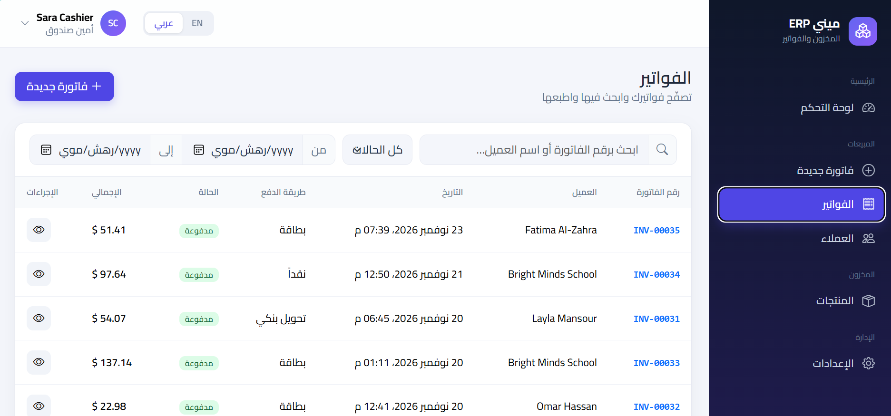
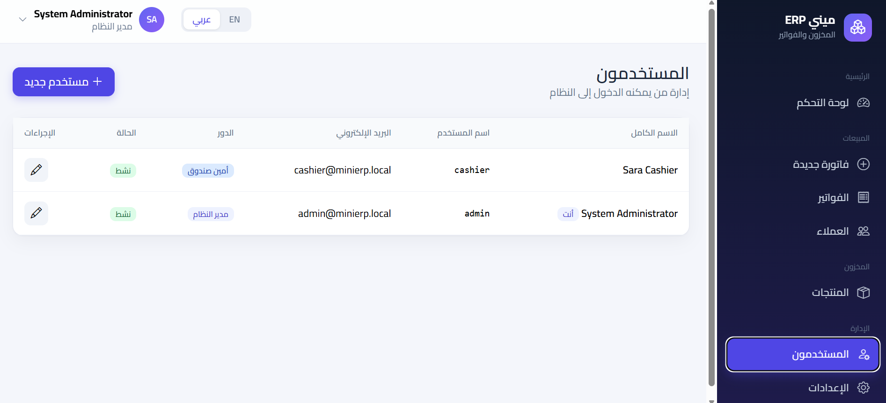
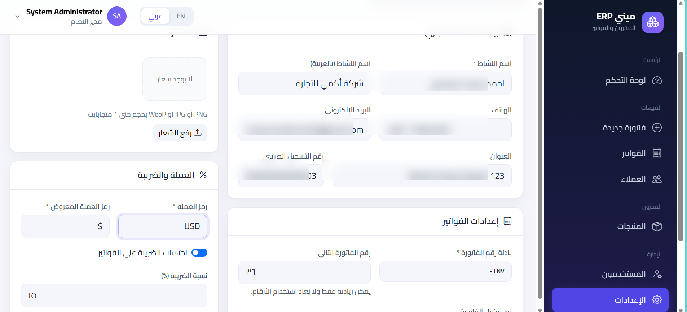
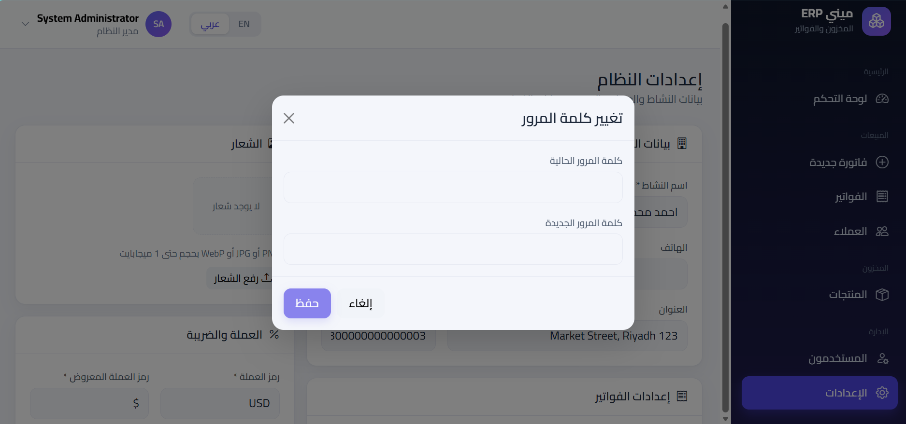

# Mini ERP – Inventory & Invoicing System

I built this project to make the daily work of a small business easier to manage. It brings products, stock, customers, and sales invoices together in one application.

The system has two user roles: **Admin** and **Cashier**. It also supports **English and Arabic**, with the layout switching between LTR and RTL when the language changes.

## Screenshots

Here are a few screens from the application.

### Login



### Dashboard

| English | Arabic |
|---|---|
|  |  |

### Products and inventory



### Customers



### Invoices

| English | Arabic |
|---|---|
|  |  |

### Users and settings

| Users | Settings |
|---|---|
|  |  |

### Change password



## What the system does

- Add, update, and archive products.
- Keep track of stock levels and stock changes.
- Add and manage customers.
- Create invoices with multiple products, discounts, and tax.
- View and print invoices.
- Restore stock when an invoice is cancelled.
- See sales totals, recent invoices, and low-stock items on the dashboard.
- Manage user accounts and their permissions.
- Use the application in Arabic or English.

## User roles

**Admin** can manage products, stock, customers, users, invoices, and system settings.

**Cashier** can view products and stock, work with customers, and create, view, and print invoices. Cashiers cannot manage users or change administrative settings.

The API also checks permissions, so access is not controlled only by hiding buttons in the interface.

## Built with

- ASP.NET Core 8 Web API and C#
- Entity Framework Core 8
- SQL Server
- Angular and TypeScript
- Bootstrap 5 and SCSS
- Chart.js
- JWT authentication and BCrypt password hashing

## A note about invoices and stock

When an invoice is created, the API checks the available stock and calculates the totals before saving it. The invoice and stock update are handled in a database transaction. If there is not enough stock, the invoice is rejected. Product details and prices are saved with each invoice so that older invoices do not change when a product is edited later.

Cancelling an invoice returns its quantities to stock. The system prevents the same invoice from restoring stock more than once.

## Run it locally

### Requirements

- .NET 8 SDK
- Node.js 20 or later and npm
- SQL Server (SQL Server Express or LocalDB will work for development)

### 1. Set the database connection

Open `backend/MiniErp.Api/appsettings.json` and update `ConnectionStrings:Default` if your SQL Server instance is different.

For SQL Server Express, the connection string looks like this:

```json
{
  "ConnectionStrings": {
    "Default": "Server=.\\SQLEXPRESS;Database=MiniErp;Trusted_Connection=True;TrustServerCertificate=True;MultipleActiveResultSets=False"
  }
}
```

### 2. Create or update the database

Run these commands from the repository root:

```powershell
dotnet tool restore
dotnet ef database update --project backend\MiniErp.Api --startup-project backend\MiniErp.Api
```

In Development, the application can also apply migrations and add sample data when the development seed setting is enabled.

### 3. Start the API

```powershell
cd backend\MiniErp.Api
dotnet run --launch-profile http
```

The API runs at `http://localhost:5080`. Swagger is available at `http://localhost:5080/swagger`.

### 4. Start Angular

Open another terminal:

```powershell
cd frontend
npm install
npx ng serve --port 4200
```

Open `http://localhost:4200` in your browser.

## Demo accounts

These accounts are for local development only:

| Role | Username | Password |
|---|---|---|
| Admin | `admin` | `Admin@123` |
| Cashier | `cashier` | `Cashier@123` |

Change or disable these accounts before deploying the application anywhere public.

## API

The main API areas are authentication, products, customers, invoices, users, settings, and dashboard. Open Swagger at `/swagger` to see the available routes and request details.

## Author

**Ahmed Mohammed Esmail**  
GitHub: [ahmed-machines](https://github.com/ahmed-machines)

---

This is a portfolio project I built to practise connecting a real backend, database, and frontend around everyday business tasks.
